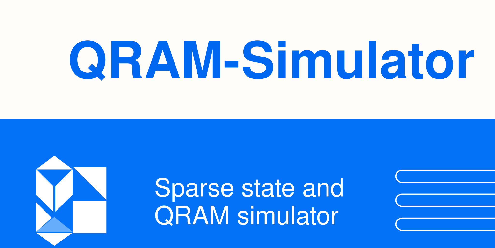

<p align="center">
  
</p>

English | [简体中文](README_zh-cn.md)

# QRAM-Simulator

[](https://arxiv.org/abs/2503.13832)
[](https://arxiv.org/abs/2503.15118)
[](https://pypi.org/project/qram-simulator/)
[](https://opensource.org/licenses/Apache-2.0)
[](https://github.com/IAI-USTC-Quantum/QRAM-Simulator)
[](https://github.com/IAI-USTC-Quantum/QRAM-Simulator/actions/workflows/cmake-multi-platform.yml)
[](https://iai-ustc-quantum.github.io/QRAM-Simulator/)

> **QRAM circuit simulation core (C++ base repository)**: two QRAM architectures (Qutrit/Qubit), noise models, QRAM paper experiments, and pybind11 Python bindings

## Standalone experiment

The installed package supplies its own native CPU experiment and local graphical
interface, without depending on a separate demo-suite checkout:

```bash
qram-simulator info
qram-simulator gui
qram-simulator run --channel Damping --probability 0.001 --out experiment.json
qram-simulator run --depth 20 --inputs 16 --trajectories 32 --out depth20.json
qram-simulator words --address-width 129 --data-width 193 --records 8 --inputs 4
qram-simulator addressing --layers 3 --channel Depolarizing --probability 0.001
qram-simulator addressing --evaluate recorded-addressing.json
qram-simulator evidence --outdir records
```

The GUI opens a local browser and supports all four noise channels, parameter
editing, trajectory plots and JSON downloads. Each run uses an isolated native
worker. Large runs use the CLI; the GUI limits depth to12, bus width to2,
inputs to32, trajectories to64 and probability to0.1, with a60-second deadline
(the addressing panel allows 256 trajectories; the fixed task-2.1 evidence
replay panel keeps the recorded 2048-trajectory configuration with its own
labeled 300-second deadline). The CLI supports depth20 (1048576 random
records), up to8 data bits,1024 input addresses and4096 trajectories. Set
`--probability 0 --channel none` for the noiseless reference. Noise
trajectories share a fixed random memory and a fixed coherent address input
(zero bus); the same seed reproduces samples on the same backend.

JSON records the one-byte-per-record SHA256, exact parameters, software/runtime,
query and routing registers, full-state overlap (`fidelity`) and reduced logical
query fidelity (`logical_fidelity`) before measurement, trace error, timings,
and separate 95% Hoeffding sampling intervals. The logical observable traces
out routing registers while retaining coherence between input addresses; it is
not postselected. Its canonical input has one zero-bus, ground-tree column per
address, with normalized nonnegative weights. General coherent bus columns are
rejected rather than silently interpreted as probabilities. These intervals
are marginal per observable, not a joint coverage certificate. The existing
full-state overlap retains its original definition. See the
[derivation and independent density-matrix cross-check](docs/sphinx/source/en/paper/joint_damping.md). Sampled input
addresses do not certify testing every memory address. Routing qubits are QRAM
architecture resources, not a fault-tolerant physical-qubit estimate. These
experiments are not hardware or end-to-end performance certificates. Installation
for developers remains `python -m pip install .`; desktop delivery bundles can
launch the same entry point without exposing this step to end users.

### Wide sparse word queries (`words` / `SparseWordMemory`)

`qram-simulator words` demonstrates the **ideal sparse XOR query semantics**
on logical words of arbitrary width — 129, 193, 256 bits and beyond, carried
exactly by several 64-bit machine words with no truncation:

- `qram_simulator.SparseWordMemory(address_width, data_width, cells)` holds a
  zero-default sparse dict of exact arbitrary-precision words;
  `.xor(address, data=0)` is the classical XOR read (self-inverse);
  `.apply_xor(state, address_bits, data_bits, backend, conditions=())` emits
  real native X / controlled-X operations on `(word_register_name, bit_index)`
  coordinates — the operator protocol frozen with the SparQSim owner, whose
  CMake installs this repository's `word_memory.py` as `pysparq/_qram_words.py`
  (single source, no copy maintained in SparQSim);
- conditions are `(little_endian_bits, expected_value)` pairs; a zero control
  coinciding with an address bit restricts the query instead of re-addressing
  the cell, and shared controls merge with the address pattern;
- the packaged `qram_simulator.word_backend.ReferenceWordBackend` is a real
  exact-statevector executor used by the CLI/GUI demo and the test chain; the
  shared fixture `bindings/python/test/fixtures/word_query_fixture.json`
  (`qram.word-query-fixture.v1`) lets QRAM-Simulator and SparQSim verify their
  two independent native backends on identical source data.

Capacity notions stay distinct: the *nominal address space* `2**address_width`
bounds address labels only — no entity, qubit or tree node is allocated for it;
the *sparse records* are the only stored objects; *allocatable capacity* is
whatever the caller's native backend provides. This ideal path is separate from
the noisy bucket-brigade routing above and involves no noise channel claim. The
GUI exposes the same query as the **宽字稀疏查询** panel.

### Noisy addressing & mitigation simulation reference (`addressing`)

`qram-simulator addressing` is the task-2.2 simulation reference: a 2–3 layer
QRAM (4 or 8 seeded records) under any of the four channels, addressed by a
uniform coherent superposition over all records. It reports the mean
`(address:bus)` output distribution, the raw correct-addressing probability,
and a **mitigation simulation** — the bus flip rate is calibrated against the
known memory and inverted with the symmetric single-bit confusion matrix per
address. The GUI exposes the same reference as the **寻址缓解仿真** panel. The `>=0.75` mitigated-addressing criterion uses the direct task-sheet
sub-item semantics (`>=`, value and operator recorded in the JSON). The
versioned JSON (`qramsim.addressing.v1`) is the offline standard I/O for the
uniqc side; `--evaluate` re-imports a record (from this software or the
declared uniqc consumer), validates it and recomputes the criterion offline
— historical data stays historical, and nothing here is a hardware run. The
noiseless reference is exact (raw = mitigated = 1); the independent
QuTiP/uniqc circuit-level baseline cross-checks the same zerobus addressing
distribution bitwise in CI. The fixed [task-4 test plan](docs/sphinx/source/en/guide/task4_test_plan.md)
documents the seeded 2-3 layer / 4-8 record data, the QPU-side data access
and the existing mitigated-fidelity records.

### Task-2.1 depth-20 four-channel evidence replay

`qram-simulator evidence` packages the fixed task-2.1 material — 20 layers,
1,048,576 seeded random records, the four channels on one identical input —
as a standard software entry with sixteen explicit same-depth theory anchors
(noiseless identity, phase-flip vacancy prediction, X-type residue collapse,
first-order Pauli composition, damping K0 occupation scale, normalization).
It verifies the replayed memory digest against the recorded v0.3.0 value,
embeds seeds, per-trajectory samples, formulas and provenance in the
`qramsim.depth20-four-channel.v1` summary, and is exposed identically as the
GUI **任务2.1 四信道证据复算** panel; the repository tool
`tools/depth20_four_channel.py` is a thin wrapper over the same packaged
module. See the [evidence replay guide](docs/sphinx/source/en/guide/evidence.md).

## Repository Split

This repository is the C++ base: QRAM circuit core + paper experiments + **pybind11 thin bindings** (the `qram-simulator` PyPI package); the SparQ framework (sparse-state simulator, algorithm library, pysparq rich bindings, and algorithm experiments) lives in the SparQSim repository:

| Repository | Contents | PyPI Package |
|------|------|---------|
| **QRAM-Simulator** (this repository) | C++ QRAM circuit core (Common + QRAM) + QRAM paper experiments + pybind11 thin bindings | `qram-simulator` |
| [SparQSim](https://github.com/IAI-USTC-Quantum/SparQSim) | SparQ framework (sparse-state simulator, algorithm library, pysparq rich bindings, algorithm experiments) | `pysparq` |

Dependency direction: **SparQSim → QRAM-Simulator**. SparQSim consumes this repository as a git submodule (relative URL `../QRAM-Simulator.git`) and builds the C++ core; the two repositories are tagged and released independently, and before a SparQSim release the submodule is pinned to the corresponding tag of this repository.

## Core Capabilities

- **QRAM circuit simulation**: two implementations, Qutrit-based ([`qram_circuit_qutrit.h`](https://github.com/IAI-USTC-Quantum/QRAM-Simulator/blob/main/QRAM/include/qram_circuit_qutrit.h)) and Qubit-based ([`qram_circuit_qubit.h`](https://github.com/IAI-USTC-Quantum/QRAM-Simulator/blob/main/QRAM/include/qram_circuit_qubit.h))
- **Noise models**: depolarizing (Depolarizing) and amplitude damping (Damping), with probability parameter range validation
- **Architecture pruning**: the qubit architecture's normal (pruned) mode and full (unpruned) mode are cross-checked version by version
- **Common components**: sparse/dense matrices, random engines, error handling, state manipulators, and more
- **MPI ensemble parallelism**: `qram_simulator.mpi` shards noisy Monte-Carlo trajectories across single-node CPU processes with deterministic per-trajectory reseeding, so aggregate results are independent of the process count ([guide](docs/sphinx/source/en/guide/mpi.md))

## C++ Quick Start

### Build

```bash
git clone https://github.com/IAI-USTC-Quantum/QRAM-Simulator.git
cd QRAM-Simulator
mkdir build && cd build

# Configure (CPU default; add -DQRAM_ENABLE_CUDA=ON for the optional CUDA build)
cmake .. -DCMAKE_BUILD_TYPE=Release

make -j$(nproc)
```

GPU builds are optional: configure with `-DQRAM_ENABLE_CUDA=ON` and an installed CUDA toolkit. CPU remains the default; production CondRot kernels that are not implemented on the GPU still use CPU fallbacks. A successful build is not a GPU performance certificate. The actively developed GPU path — the CUDA sparse-state simulator — lives in the sister repository [SparQSim](https://github.com/IAI-USTC-Quantum/SparQSim), verified on an 8×A800 server with CUDA 12.8 ([v1c verification record](https://github.com/IAI-USTC-Quantum/SparQSim/blob/main/docs/verification/v1c-gpu-cuda-a800.md)).

A driver-free development toolkit can be assembled from pinned official NVIDIA
redistributables (Linux x86_64, Python 3.12+):

```bash
python tools/bootstrap_cuda.py --release 13.3.0 --output build-cuda/toolkit
cmake -S . -B build-cuda/native -DQRAM_ENABLE_CUDA=ON -DCMAKE_CUDA_ARCHITECTURES=80 -DCMAKE_CUDA_COMPILER="$PWD/build-cuda/toolkit/prefix/bin/nvcc"
cmake --build build-cuda/native --target SparQ_Common_cuda SparQ_QRAMSimulator_cuda
```

The pinned choices are CUDA 12.8.1 and 13.3.0 (`--release`); both are compile-tested.
The bootstrap verifies component sizes/SHA256 and preserves licenses. It installs
no drivers or system packages. The explicit architecture allows a compilation check
without a GPU; runtime correctness and throughput still require the target device.

### Parallel & GPU support matrix

| Capability | Status | Where verified | Re-test entry |
|---|---|---|---|
| Native CPU engine (wheel/sdist, Linux+Windows) | verified | `python-bindings` CI matrix (py3.10/3.12), local runs | `pytest bindings/python/test` |
| C++ core tests (both architectures) | verified | `cmake-multi-platform` CI; local ctest 5/5 | `ctest --test-dir build-cpu` |
| Four-channel Kraus reference (independent QuTiP/uniqc backend) | verified | `core-contracts` CI job | `pytest bindings/python/test -q -rs` |
| CPU ensemble MPI, single node, real 4 ranks | verified | `core-contracts` CI (mpich); local 4-rank run | `pytest bindings/python/test/test_mpi_ensemble.py` under `mpirun`-equipped env |
| CUDA 12.8.1 and 13.3.0 libraries, sm_80 | **compile-verified only** (no GPU run) | `core-contracts` CI cuda matrix | `tools/bootstrap_cuda.py` + the cmake CUDA configure/build from this README |
| CUDA runtime correctness/throughput | **not tested here — no GPU** | none in this repository | on a GPU host: build with `QRAM_ENABLE_CUDA=ON`, run the C++ ctest suite; record device/driver/toolkit |
| Multi-GPU / distributed sparse-state slicing | **out of scope here** | GPU sparse-state execution lives in SparQSim (8×A800, CUDA 12.8 record) | SparQSim verification records |
| ≥10⁶-dimension / 200k-grid application scenarios | via SparQSim + applications on target hardware | cross-repo | application repositories' fixed entries |

The CPU ensemble MPI entry is trajectory-level parallelism on one node; it is
not multi-GPU execution and not a distributed sparse-state partitioning (see
[the MPI guide](docs/sphinx/source/en/guide/mpi.md)). Million-dimensional
state-vector and 200k-grid scenarios are consumed by SparQSim and the
application repositories on their verified hardware; this repository supplies
the QRAM query core and keeps the untested-hardware items explicit.

Build options (each controllable via `-D...=ON/OFF`):

| Option | Default | Description |
|------|------|------|
| [`QRAM_BUILD_TESTS`](https://github.com/IAI-USTC-Quantum/QRAM-Simulator/blob/main/CMakeLists.txt) | ON | Build the C++ tests (test/) |
| [`QRAM_BUILD_EXPERIMENTS`](https://github.com/IAI-USTC-Quantum/QRAM-Simulator/blob/main/CMakeLists.txt) | ON | Build the QRAM experiment programs (Experiments/) |

### Core Usage

```cpp
#include "qram_circuit_qubit.h"

using namespace qram_simulator;
using namespace qram_qubit;

// 1. Construct the QRAM circuit (addr_size=4, data_size=2)
QRAMCircuit qram(4, 2);
qram.set_memory_random();                     // random data tree

// 2. Inject noise (optional; probability range validation, Damping requires gamma < 1)
qram.set_noise_models({
    { OperationType::Depolarizing, 1e-3 },
    { OperationType::Damping, 1e-4 }
});

// 3. Run (normal = architecture pruning / full = unpruned baseline)
qram.set_input_uniform(100);
qram.run_normal();

// 4. Sample the fidelity
double fidelity = qram.sample_and_get_fidelity();
```

## Python Quick Start

```bash
pip install qram-simulator
```

The binding layer ([`bindings/python/`](https://github.com/IAI-USTC-Quantum/QRAM-Simulator/tree/main/bindings/python), pybind11) exports the core working classes: [`QRAMCircuitQubit`](https://iai-ustc-quantum.github.io/QRAM-Simulator/en/api/cpp.html#cppapi-qramcircuit-qubit) / [`QRAMCircuitQutrit`](https://iai-ustc-quantum.github.io/QRAM-Simulator/en/api/cpp.html#cppapi-qramcircuit-qutrit) (the two architecture circuits), [`QRAMFullAmp`](https://iai-ustc-quantum.github.io/QRAM-Simulator/en/api/cpp.html#cppapi-qramfullamp) (full-amplitude bridge), [`TimeStep`](https://iai-ustc-quantum.github.io/QRAM-Simulator/en/api/cpp.html#cppapi-timestep) (time-step and noise scheduling), [`OperationType`](https://github.com/IAI-USTC-Quantum/QRAM-Simulator/blob/main/QRAM/include/time_step.h), and global random-seed control, so external libraries can drive the full construct → set noise → run → fidelity workflow directly:

```python
from qram_simulator import QRAMCircuitQubit, OperationType, set_seed

set_seed(42)
qram = QRAMCircuitQubit(4, 2)
qram.set_memory_random()
qram.set_noise_models({OperationType.Depolarizing: 1e-3,
                       OperationType.Damping: 1e-4})
qram.set_input_uniform(100)
qram.run_normal()
print(qram.sample_and_get_fidelity())
```

Local development: `pip install -v .` (CMake >= 3.18 + C++17 + OpenMP); tests: `pytest bindings/python/test`.

### Circuit-Level Baseline (UnifiedQuantum)

`pip install "qram-simulator[baseline]"` additionally enables `qram_simulator.baseline`: a gate-level (circuit-level) re-implementation of the qubit-architecture QRAM on the [UnifiedQuantum](https://github.com/IAI-USTC-Quantum/UnifiedQuantum) (uniqc) QuTiP density-matrix backend, supporting 1-2 tree layers, with noise channels placed on the QRAM routing tree only. It cross-checks `QRAMCircuitQubit` semi-quantitatively under convention-identical fidelity metrics:

```bash
python -m qram_simulator.baseline.compare --addr 2 --runs 500 --outdir results
```

The default `faithful` baseline now uses the standard whole-tree Kraus channel, matching the current qubit engine (`QUBIT_DAMPING_CONVENTION=joint_auxiliary_whole_tree_v1`). Complete-channel traces are one; the old `survival` JSON key is retained as a compatibility alias, not a no-jump probability. Explicit `legacy` and `nojump` modes are historical/conditional diagnostics, not standard-channel validation. See [the channel derivation](docs/sphinx/source/en/paper/joint_damping.md) and [baseline conventions](bindings/python/qram_simulator/baseline/README.md). Historical [packaged results](bindings/python/qram_simulator/baseline/results.md) predate the corrected joint damping model and must not be used as its validation.

### MPI Ensemble Parallelism

`qram_simulator.mpi` parallelizes noisy QRAM Monte-Carlo ensembles across CPU processes under MPI — ranks shard trajectories cyclically, every trajectory is reseeded deterministically (`set_seed(seed + index)`), and rank 0 aggregates, so the results are **independent of the process count** (per-trajectory samples bit-identical; histogram up to float summation order):

```python
import qram_simulator as qs
from qram_simulator.mpi import run_ensemble, world_comm

comm = world_comm()          # mpi4py COMM_WORLD under mpirun; SerialComm otherwise
res = run_ensemble(qs, depth=20, data_size=1,
                   noise={qs.OperationType.PhaseFlip: 1e-5},
                   runs=100, seed=20261105, memory=memory_list, comm=comm)
if res is not None:          # rank 0 only
    ...                      # res["hist"], res["overlap_fid"], res["mpi"]["nranks"], ...
```

```bash
mpirun -np 4 python noisy_ensemble.py    # each rank enters the script once
```

The four-rank host-memory regression defaults its child process to
`UCX_TLS=tcp,self`, following the
[UCX transport configuration](https://openucx.readthedocs.io/en/master/faq.html#selecting-networks-and-transports).
Some hosted VMs expose a MANA verbs device but reject the UD queue-pair
operation selected by automatic discovery. An explicit caller transport
setting is respected; production library defaults are unchanged. This test
still starts four actual MPI ranks and compares their output with serial
execution. It is not an RDMA or GPU-memory transport benchmark.

`mpi4py` is optional at runtime — without it (or without `mpirun`) the same code path runs serially via `SerialComm`, which keeps the module importable and CI-testable. Honest scope: single-node multi-process **CPU** ensemble parallelism — the bindings are CPU-only (`gpu_per_rank = 0` is recorded honestly), this is not multi-GPU and not a distributed sparse-state partitioning. Details: [docs/sphinx/source/en/guide/mpi.md](docs/sphinx/source/en/guide/mpi.md); tests: `bindings/python/test/test_mpi_ensemble.py`.

### Consuming as a CMake Subproject (the SparQSim Way)

```cmake
# submodule: git submodule add ../QRAM-Simulator.git extern/qram-simulator
set(QRAM_BUILD_TESTS OFF CACHE BOOL "" FORCE)
set(QRAM_BUILD_EXPERIMENTS OFF CACHE BOOL "" FORCE)
add_subdirectory(extern/qram-simulator)   # provides the SparQ_QRAMSimulator / SparQ_Common targets and the flattened header layout
```

### Running Experiments

```bash
# QRAM fidelity experiment (V2)
./build/bin/Experiment_QRAM_FidelityV2 ...
```

For the Python side (pysparq full-featured rich bindings and the qram_simulator thin bindings), see the [SparQSim](https://github.com/IAI-USTC-Quantum/SparQSim) repository.

## Papers and Citation

This repository is driven by two papers:

### Paper 1: QRAM-Simulator — [arXiv:2503.13832](https://arxiv.org/abs/2503.13832)

> *Efficient Simulation of Quantum Random Access Memory*

- **QRAM circuit simulation**: Qutrit-based and Qubit-based QRAM implementations (C++ API) with depolarizing and amplitude damping noise models
- **Sparse-state optimization**: stores only non-zero amplitudes, enabling simulation of structured algorithms with 64+ qubits
- **Error filtering**: error filtering schemes for noisy QRAM

**Corresponding code**: [`QRAM/`](https://github.com/IAI-USTC-Quantum/QRAM-Simulator/tree/main/QRAM), [`Experiments/QRAM/`](https://github.com/IAI-USTC-Quantum/QRAM-Simulator/tree/main/Experiments/QRAM) (the error-filtering experiments live in the SparQSim repository)

### Paper 2: SparQ — [arXiv:2503.15118](https://arxiv.org/abs/2503.15118)

> *SparQ: A Sparse Quantum Circuit Simulator with Register-Level Abstraction*

Extends Register Level Programming into a general-purpose sparse-state quantum simulator (QFT, Grover, Hamiltonian simulation, QDA, QCNN, and other algorithms, plus an extended algorithm library).

**Corresponding code**: `SparQ/`, `SparQ_Algorithm/`, and the algorithm experiments have been migrated to the [SparQSim](https://github.com/IAI-USTC-Quantum/SparQSim) repository ([`SparQ/`](https://github.com/IAI-USTC-Quantum/SparQSim/tree/main/SparQ), [`SparQ_Algorithm/`](https://github.com/IAI-USTC-Quantum/SparQSim/tree/main/SparQ_Algorithm), [`Experiments/`](https://github.com/IAI-USTC-Quantum/SparQSim/tree/main/Experiments)).

### BibTeX

```bibtex
@article{sun2025sparqsim,
  title={SparQSim: Simulating Scalable Quantum Algorithms via Sparse Quantum State Representations},
  author={Sun, Tai-Ping and Chen, Zhao-Yun and Wang, Yun-Jie and Xue, Cheng and Liu, Huan-Yu and Zhuang, Xi-Ning and Xu, Xiao-Fan and Wu, Yu-Chun and Guo, Guo-Ping},
  journal={arXiv preprint arXiv:2503.15118},
  year={2025}
}

@article{wang2025refined,
  title={Refined Criteria for QRAM Error Suppression via Efficient Large-Scale QRAM Simulator},
  author={Wang, Yun-Jie and Sun, Tai-Ping and Zhuang, Xi-Ning and Xu, Xiao-Fan and Liu, Huan-Yu and Xue, Cheng and Wu, Yu-Chun and Chen, Zhao-Yun and Guo, Guo-Ping},
  journal={arXiv preprint arXiv:2503.13832},
  year={2025}
}
```

### Reproducing the Paper Results

- [Pruned/full exactness validation](docs/sphinx/source/en/paper/exactness_validation.md): complete-state comparisons, regression coverage and reproduction commands.

Detailed guides for reproducing the experiments live in the [docs/sphinx/source/en/paper/](docs/sphinx/source/en/paper/) directory:

- [docs/sphinx/source/en/paper/README.md](docs/sphinx/source/en/paper/README.md) - paper-related documentation
- [docs/sphinx/source/en/paper/reproduction.md](docs/sphinx/source/en/paper/reproduction.md) - [QRAM-Simulator](https://arxiv.org/abs/2503.13832) experiment reproduction guide

## Project Structure

```
QRAM-Simulator/
├── QRAM/               # QRAM circuit implementations (Qutrit/Qubit-based)
├── Common/             # common components (matrices, random engines, state manipulators, etc.)
├── bindings/python/    # pybind11 thin bindings (the qram-simulator PyPI package)
├── Experiments/        # QRAM paper experiments (QRAMFidelityV2, QubitPaper, ChannelCorrespondence, etc.)
├── test/               # C++ tests (the Common/QRAM portions)
├── ThirdParty/         # vendored dependencies (Eigen, fmt, googletest, argparse)
└── docs/               # Sphinx docs (breathe pulls in the Doxygen C++ API + autoapi Python API)
```

## Release Process

1. Merge a validated pull request into GitHub `main`, then verify its main-branch checks;
2. Build and install candidate wheels, including their native extension, CLI,
   packaged GUI and third-party notices. A manual `pypi-publish.yml` dispatch
   builds and tests the complete release matrix without publishing;
3. Update [`CHANGELOG.md`](CHANGELOG.md) and push a new immutable `vX.Y.Z`
   tag on the validated main commit;
4. That tag triggers cp310-cp313 manylinux / win_amd64 wheel and sdist builds.
   Each repaired release wheel runs `tools/check_installed_product.py` in a
   clean test environment: it checks installed notice hashes and assets, then
   runs the native computation, CLI and HTTP GUI tests. PyPI trusted publishing
   waits for every build and test to pass. Creating a GitHub Release afterward
   does not trigger a second upload. `pysparq` is released separately from
   SparQSim.

## About Us

This project is developed by **[IAI-USTC Quantum](https://github.com/IAI-USTC-Quantum)**.

- **GitHub Organization**: [IAI-USTC-Quantum](https://github.com/IAI-USTC-Quantum) — browse all of the team's open-source projects
- **Documentation**: [iai-ustc-quantum.github.io](https://iai-ustc-quantum.github.io/) — team documentation and project homepages

IAI-USTC Quantum is the quantum artificial intelligence team at the Institute of Artificial Intelligence, Hefei Comprehensive National Science Center.

Main developers: Agony5757 (chenzhaoyun@iai.ustc.edu.cn), RichardSun, Itachixc, YunJ1e, cilysad, TMYTiMidlY

## Related Projects

- [SparQSim](https://github.com/IAI-USTC-Quantum/SparQSim) - the SparQ framework and Python ecosystem (pysparq): the CUDA sparse-state quantum virtual machine plus the quantum algorithm library. Recent linear-solver results on A800 (CUDA 12.8): the QDA discrete-adiabatic solver and the CKS linear solver with QRAM-free direct oracles each completed 2^20-dimensional Poiseuille tridiagonal production runs (CKS: directional residual 0 ≤ 1e-6, fidelity 1.0, 44.7 min) — verification records [v1d](https://github.com/IAI-USTC-Quantum/SparQSim/blob/main/docs/verification/v1d-qda-linsolver-a800.md) / [v1e](https://github.com/IAI-USTC-Quantum/SparQSim/blob/main/docs/verification/v1e-cks-direct-oracle-linsolver.md)
- [UnifiedQuantum](https://github.com/IAI-USTC-Quantum/UnifiedQuantum) - a unified quantum computing framework

## License

Apache-2.0 License
